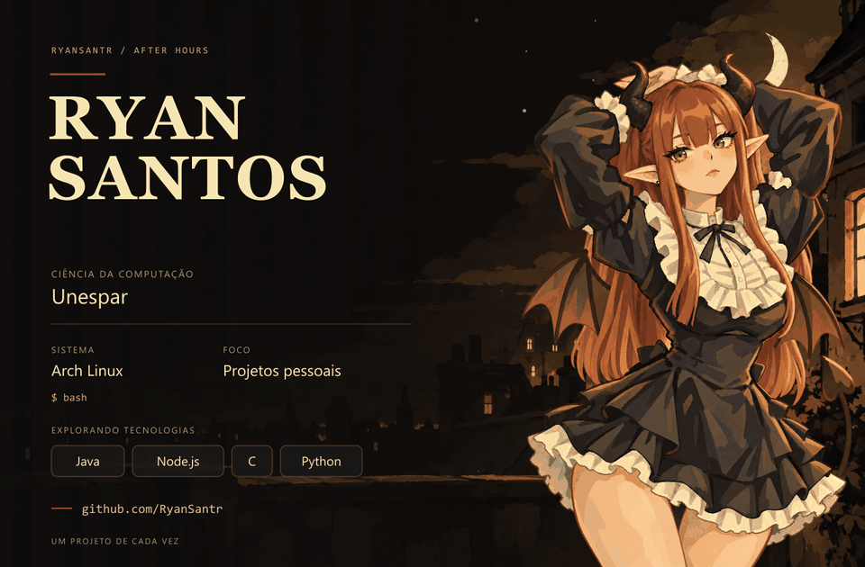

  

  
Sobre mim

**Ryan Santos** · Ciência da Computação — Unespar

- **Sistema:** Arch Linux · bash
- **Foco:** projetos pessoais
- **Tecnologias que estou explorando:** Java, Node.js, C e Python
- **GitHub:** [RyanSantr](https://github.com/RyanSantr)

